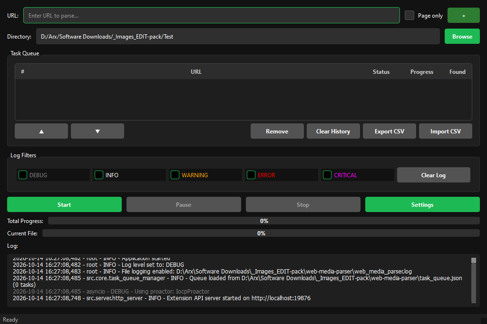
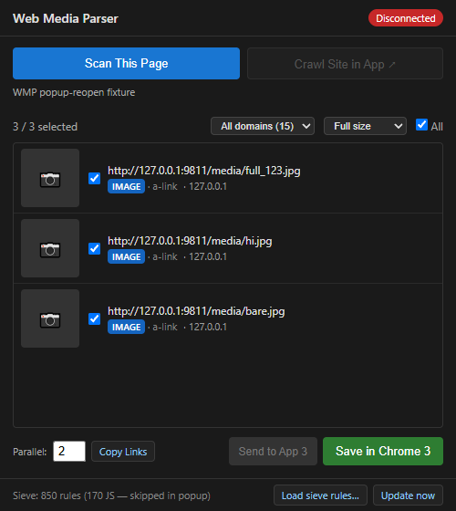

# Web Media Parser

<p align="center">
  <a href="README_EN.md">🇬🇧 <b>English</b></a> | <a href="README.md">🇷🇺 <b>Русский</b></a>
</p>

<p align="center">
  
  
  
  
  
</p>

**An intelligent desktop application (PySide6) and companion browser extension (Chrome MV3) for crawling, discovering full-size originals, and batch-downloading media files.**

Automatically detects images and videos, upgrades thumbnails to high-resolution originals using an Imagus Sieve database (820+ rules), bypasses anti-scraping protections (cookie consent, age gates, JS redirects), isolates per-domain concurrency, and provides fast multi-threaded resume-capable downloads.

<p align="center">
  
</p>

---

## Features

### Smart Media Discovery
- **Full-size from thumbnails** — Transforms thumbnail URLs to full-resolution originals using built-in site patterns and Imagus Sieve rules (including JS rules).
- **URL prioritization** — Direct media links are processed first; navigation and site chrome are deferred.
- **Junk & preview filtering** — Automatically discards tracking pixels, ad banners, icons, tiny placeholders, and unwanted formats.
- **Lazy-load detection** — Extracts images from `data-src`, `srcset`, inline CSS rules, and inline JavaScript.
- **Domain concurrency capping** — Caps concurrent requests to a maximum of 2 per domain (crawler + downloader combined).

### Protection & Dynamic Content Bypass
- **Cookie consent bypass** — Automatically detects and injects consent cookies.
- **Age-gate / Gateway bypass** — Static consent cookie extraction from `onclick` handlers (always active) + targeted DOM clicks via Deno when `js_engine=deno`; gateway bypass cached per domain.
- **JS redirects** — Detects and follows client-side JavaScript redirects (up to 5 hops).
- **HTTP 429 rate limit backoff** — Automated exponential backoff respecting the `Retry-After` header.
- **Fallback aiohttp → requests/curl_cffi** — If asynchronous requests are blocked, transparently falls back to synchronous `requests` (or `curl_cffi` browser TLS impersonation) with full browser header sets.
- **HTTP Engine (curl_cffi)** — Optional browser TLS fingerprint impersonation (JA3/JA4/HTTP2) for downloading and fallback fetches (see [HTTP Engine (curl_cffi)](#http-engine-curl_cffi)).
- **Auto-escalate on blocks** — On HTTP 403 or exhausted 5xx retries, executes a single bounded curl_cffi attempt before quarantine.

### Pattern & Sieve Engine
- **Built-in site patterns** — Ready-to-use patterns for popular media galleries and platforms.
- **Custom patterns (JSON)** — Easily add custom extraction rules with `image_transformations`.
- **Imagus Sieve support** — Import Imagus rules; JS rules can be executed safely via sandbox or static translation.
- **JS Engine (Deno)** — Optional lightweight sandboxed JS engine for complex sieve rules and dynamic DOM mutation (see [JS Engine (Deno)](#js-engine-deno)).
- **Page only mode** — Download media from the target page only without crawling linked pages.

### Task Queue & Management
- **Multi-task queue** — Queue multiple URLs with pause, resume, and stop controls.
- **Auto-start next task** — Automatically starts the next pending task upon natural completion.
- **CSV Export / Import** — Backup or batch-import task lists via CSV.
- **History cleanup** — Clean up completed tasks and session caches while preserving downloaded files.

### Download Capabilities
- **Multi-threaded downloads** — Configurable thread pools for both parsing and file downloading.
- **Multi-segmented downloads** — Download single large files in multiple chunks (supporting `Accept-Ranges`).
- **Connection reuse** — Shared HTTP sessions and connection pooling.
- **Speed limit** — Bandwidth throttling for single-thread file downloads.
- **Deduplication** — Skips previously downloaded media URLs.
- **Crash-safe state storage** — Atomic persistence of `last_session.pkl` using temporary files, fsync, and atomic rename.

### Portability & Packaging
- **Onedir bundle** — Completely portable PyInstaller onedir distribution.
- **Relative paths** — Settings, temporary sessions, and pattern databases reside next to the executable.
- **Configurable download folder** — Retains last selected output directory across launches.

### Supported Formats
- **Images:** JPEG, PNG, WebP, AVIF, BMP, TIFF (GIF, SVG, ICO, CUR disabled by default; toggleable in *Settings → Filters*).
- **Video:** MP4, WebM, OGG, MOV, MKV, AVI, FLV, M4V.
- **Audio:** MP3, WAV, AAC, FLAC, OPUS.
- **Streaming:** M3U8 (HLS), MPD (DASH).
- **APIs:** JSON endpoints — recursively extracts media objects from arbitrary data trees, nested lists, and handles pagination (`data.next`, `meta.pagination.next`).

### Chrome Extension (Manifest V3)

The extension serves both as a standalone in-browser media downloader and as a quick dispatch bridge to the desktop application queue.

<p align="center">
  
</p>

**Operating Modes:**

| Mode | Button | Action |
|---|---|---|
| **Page only** ✓ | **Send to App** | Scans current page → sends selected media list to the desktop application queue |
| **Page only** ✗ | **Parse Page** | Sends page URL to the desktop app for deep recursive crawling (crawler, sieve, deep crawl) |
| Any | **Save (Chrome)** | Downloads selected files directly inside Chrome with configurable concurrency (`Parallel: 1–10`) |
| — | **Ctrl+Shift+S** | Hotkey: instantly scans and downloads all full-size media via Chrome |
| — | **Ctrl+Shift+D** | Hotkey: quickly sends current tab URL to the desktop app queue |

**Extension Features:**
- **Deep DOM scanning**: inspects ``, `<picture>`, `srcset` (picks optimal quality by DPR and width), CSS backgrounds, videos and posters, and direct `a[href]` links.
- **Bundled Imagus Sieve**: 823 verified rules (v2026.07.15) for immediate thumbnail-to-original upgrade.
- **Full autonomy**: `Save (Chrome)` works standalone without running the desktop companion app.
- **Companion onboarding**: when the desktop app is offline, clicking the `Disconnected` pill opens setup instructions.
- **Smart rule merge**: online sieve updates (`Update now`) from GitHub/jsDelivr preserving user rules (`_name`) and disabled status.

**Installation:**
1. Open `chrome://extensions` → enable **Developer mode**.
2. Click **Load unpacked** → select the `extension/` directory.
3. Ready to use: 823 Imagus Sieve rules are initialized automatically.

---

## Installation

### System Requirements
- **Python** 3.8+ (developed and tested on Python 3.12)
- **OS:** Windows 10/11 (primary supported platform).

### Running from Source

```bash
git clone https://github.com/Sucotasch/web-media-parser.git
cd web-media-parser
pip install -r requirements.txt
python main.py
```

### Building the Portable Package

```bash
python build_exe.py
```

Output: `dist/WebMediaParser/` — portable directory containing `WebMediaParser.exe` and bundled dependencies.

Structure:
```
dist/WebMediaParser/
├── WebMediaParser.exe
├── Imagus_sieve_2026.04.01_849.json   — Imagus rule sets
├── Imagus_sieve_2026.07.15_823.json
├── junk_allowlist.txt                 — Allowlist for junk/ad filters
├── bin/                               — Deno JS engine (when built with Deno)
│   ├── deno.exe
│   ├── worker.js                      — JS rule worker (P0)
│   ├── dom_worker.js                  — DOM worker happy-dom (P1)
│   ├── gateway_worker.js              — DOM click consent worker (P4)
│   └── deno_cache/                    — Offline npm cache (happy-dom)
├── sessions/          (created on first run)
└── _internal/
    └── resources/
        ├── dark_theme.qss
        ├── domain_blocklist.txt
        └── patterns/site_patterns.json
```

> **Deno is optional.** Without `bin/`, the application runs in Static mode; the engine can be enabled in settings.

---

## Usage

1. **Launch** the application (`python main.py` or `WebMediaParser.exe`).
2. **Enter the target URL** in the top input field.
3. **Select a download folder** (retained across sessions).
4. **Adjust settings** via *Settings* if needed (defaults are optimal for most sites).
5. Click **Start**.

### Additional Actions
- **☑ Page only** — Downloads media exclusively from the target page without traversing links.
- **Export CSV** — Saves current task queue to a CSV file.
- **Import CSV** — Restores tasks from CSV (skips completed, starts pending).
- **Clear History** — Clears task queue and cached session states while preserving downloaded files.

### Download Directory Layout

Files are organized by the source page domain and up to 2 path components:

```
<download_dir>/
└── example_com_20260412_1630/       — Task folder ({domain}_{timestamp})
    └── cdn.example.com/
        └── gallery/
            └── photo.jpg
```

---

## Configuration Settings

### Parsing
| Setting | Default | Description |
|---|---|---|
| Search Depth | 3 | Link traversal depth (0 = starting page only) |
| Page Limit | 1000 | Stop crawl after N source pages with downloads (0 = unlimited) |
| Page Timeout | 30 sec | Timeout per page request (5–600s) |
| Stay in Domain | ✓ | Restrict crawling to the initial domain |
| Process JavaScript | ✓ | Parse inline JS and lazy-load attributes |
| Use Image Patterns | ✓ | Upgrade thumbnails to full-size originals |
| Bypass Cookie Consent | ✓ | Inject common consent cookies |
| Bypass JS Redirects | ✓ | Follow client-side JavaScript redirects |
| Filter Hidden Links | ✓ | Skip hidden links (crawler trap protection) |

### Filters
| Setting | Default | Description |
|---|---|---|
| Min. Image Width | 100 px | Minimum width parsed from HTML attributes |
| Min. Image Height | 100 px | Minimum height parsed from HTML attributes |
| Min. Image Size | 40 KB | Minimum file size (verified via HTTP HEAD) |
| Min. Video Size | 1000 KB | Minimum video file size |
| Formats (checkboxes) | JPG/PNG/WebP/AVIF/BMP/TIFF | Image and video format allowlist; GIF/SVG/ICO disabled by default |
| Stop Words | word list | Segment-aware path filter (e.g. `ad` will not drop `media`) |

### Performance
| Setting | Default | Description |
|---|---|---|
| Parser Threads | 4 | Concurrency for HTML parsing |
| Downloader Threads | 8 | Concurrency for file downloads |
| Threads per File | 1 | Concurrent chunks per file (up to 8) |
| Max Speed | 0 (unlimited) | Global bandwidth limit (KB/s) |

### HTTP
| Setting | Default | Description |
|---|---|---|
| User-Agent | Chrome 130 | Outgoing User-Agent string |
| Referer | auto | Referer header policy (`auto` / `origin` / `none`) |
| Accept-Language | en-US | Language preference header |
| Timeout | 30 sec | Network request timeout |
| Retry Count | 3 | Number of retries on transient errors |
| Proxy | — | HTTP/HTTPS proxy (`host:port`) |
| **JS Engine** | Static | `Static` (default) / `Deno` — see [JS Engine (Deno)](#js-engine-deno) |
| **HTTP Engine** | Aiohttp | `Aiohttp` (default) / `curl_cffi` — see [HTTP Engine (curl_cffi)](#http-engine-curl_cffi) |
| **Escalate on block** | ✓ | On HTTP 403/5xx, try one curl_cffi attempt before failing |
| Filter Ads/Junk | ✓ | Discard advertising/tracker URLs (allowlist compatible) |

### Logging
| Setting | Default | Description |
|---|---|---|
| Enable logging to file | Off | Write detailed logs to disk |
| Log file | web_media_parser.log | Output log file path |

---

## JS Engine (Deno)

Web Media Parser can execute **Imagus Sieve JavaScript rules** through a lightweight, sandboxed Deno engine instead of static regex translation. Disabled by default (`Static`), enable via *Settings → HTTP → JS Engine → Deno*.

### Capabilities
- **P0** — JS `to`-rules (thumbnail → full-size URL transformations).
- **P1** — JS `url`/`res`-rules: fetch linked wrapper pages and extract originals via DOM (`happy-dom`) and raw text (`$._`).
- **P0.5/P1.5** — `this.node` emulation: rules relying on `this.node.closest/querySelector/src` evaluate successfully.
- **Full-size discovery** — Multi-step transitions (thumbnail → wrapper page → full-size CDN original).
- **P4 — JS Consent Gates** — Age and consent buttons: parses cookie setters from `onclick` handlers (always active) + dispatches DOM clicks in happy-dom (`js_engine=deno`); parses mutated DOM without re-fetching.

### Security
- Workers execute with **zero permissions** (no `--allow-*` flags), target page scripts are not evaluated — only sieve expressions against DOM.
- Offline npm cache is bundled in `bin/deno_cache/` — functions fully without internet access.

---

## HTTP Engine (curl_cffi)

Standard Python HTTP libraries (`aiohttp`, `requests`) utilize OpenSSL, whose TLS fingerprint (JA3/JA4 lacking GREASE tokens, HTTP/2 nuances) is easily flagged by anti-bot systems (Cloudflare, Akamai, DataDome) at the **TLS handshake level**, before HTTP headers are even inspected.

The **`curl_cffi` engine** integrates patched libcurl (curl-impersonate) to match the exact TLS and HTTP/2 handshake of real desktop Chrome browsers.

### Capabilities
- **Browser TLS impersonation** for file downloads and fallback page fetches.
- **Fail-open design**: if `curl_cffi` is unavailable, transparently falls back to `requests`.
- **Escalate on block**: when an active request receives HTTP 403 or exhausts 5xx retries, executes exactly one request via curl_cffi before recording a failure.

---

## Architecture

```
main.py
├── src/gui/
│   ├── main_window.py       — Main PySide6 window, task queue UI, worker orchestration
│   ├── settings_dialog.py   — Settings dialog (Parsing, Filters, Performance, HTTP, Logging)
│   └── log_handler.py       — PySide6 log interceptor → QTextEdit and file
│
├── src/core/
│   ├── task_item.py          — Task data model (URL, settings, one_shot, status)
│   └── task_queue_manager.py — Queue management: CRUD, lifecycle, persistence
│
├── src/parser/
│   ├── parser_manager.py     — Worker coordination, domain concurrency, page limits
│   ├── priority_url_queue.py — Heap-based priority URL queue
│   ├── webpage_parser.py     — HTML parsing, lazy-load extraction, JS redirects, consent bypass
│   ├── json_parser.py        — JSON API traversal and media extraction
│   ├── site_pattern_manager.py — Built-in patterns & Imagus Sieve transforms
│   ├── js_engine/           — Deno workers: engine.py, worker.js (P0), dom_worker.js (P1), gateway_worker.js (P4)
│   ├── junk_filter.py       — Heuristic classifier for ads, trackers, and forum badges
│   ├── http_engine.py       — HTTP engine selector: aiohttp vs curl_cffi impersonation
│   ├── shared_session.py     — Shared aiohttp.ClientSession management
│   └── utils.py              — is_media_url, normalize_url, is_banner_or_ad
│
├── src/downloader/
│   └── media_downloader.py  — Single- and multi-thread file downloader with resume
│
├── src/server/
│   └── http_server.py       — Local HTTP bridge for Chrome extension (localhost:19876)
│
├── src/
│   ├── app_paths.py          — Unified portable paths resolver
│   ├── constants.py          — Application constants and defaults
│   ├── fix_lxml.py           — lxml.html.clean runtime compatibility patch
│   └── fix_brotli.py         — Brotli decompression fix for aiohttp
│
└── resources/
    ├── dark_theme.qss        — Dark UI theme stylesheet
    ├── domain_blocklist.txt  — Built-in domain blocklist (trackers, social networks)
    ├── icon.ico              — Application icon
    └── patterns/site_patterns.json
```

---

## Troubleshooting

| Issue | Resolution |
|---|---|
| Media not detected | Enable **Process JavaScript**, ensure Imagus Sieve rules are loaded |
| Download speed is low | Increase **Downloader Threads** to 16–32 in Settings |
| Site blocks requests | Set up a **Proxy**, increase **Timeout**, set **HTTP Engine = curl_cffi** |
| 429 Rate Limit | Automated backoff is handled automatically via `Retry-After` |
| Task appears stuck | Check log output, click **Stop** for immediate termination |
| Duplicate files on Resume | Filtered automatically via downloaded files cache |

---

## Status & Engineering Audit

The codebase has undergone a comprehensive engineering audit (see detailed registry in **[`Audit.md`](Audit.md)** and verification gates in **[`GATES.md`](GATES.md)**):
- Resolved multi-thread download chunk file descriptor leaks, session configuration leakage, Content-Type validation gates preventing error HTML pages from being saved as images, and filename normalization.
- Achieved Imagus Sieve rule parity between desktop and browser extension, path-segment-aware URL filtering, and robust ad/banner categorization.
- Browser extension fully cleaned of legacy `new Function` calls and deprecated manifest properties, with full packaging documentation for Chrome Web Store distribution (see [`docs/CHROME_WEB_STORE.md`](docs/CHROME_WEB_STORE.md) and [`PRIVACY_POLICY.md`](PRIVACY_POLICY.md)).
- Test coverage: **494 passed tests** in Python (`pytest`; 30 skipped without Deno) and **15 test suites** for the Chrome extension (`Node.js`).

---

## License

[MIT License](LICENSE)

---

## Acknowledgments

- **PySide6** — Modern Qt GUI framework for Python
- **aiohttp** — High-performance asynchronous HTTP client
- **curl_cffi** — Real browser TLS fingerprint impersonation
- **BeautifulSoup 4** & **lxml** — HTML and XML parsing
- **requests** — Resilient fallback HTTP requests
- **Deno** — Lightweight sandboxed JavaScript runtime
- The [Imagus](https://github.com/Imagus/imagus) project for sieve rule definitions
